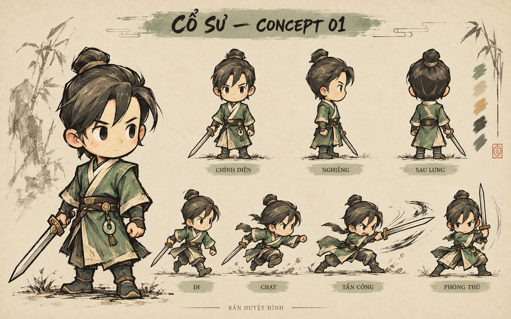
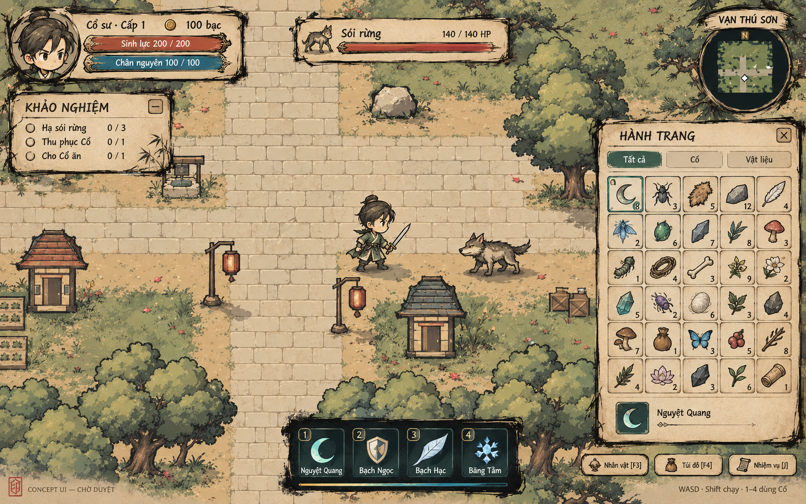

# Concept nhân vật và UI — hướng triển khai đã chọn

Người dùng yêu cầu tạo ảnh nhân vật để duyệt trước khi triển khai. Hai ảnh ở thư mục này là concept do imagegen tích hợp tạo. Bộ nhân vật đã được đưa vào pilot runtime theo yêu cầu tiếp theo; UI concept 01 hiện là hướng thị giác được chọn để restyle HUD và cửa sổ. Riêng chân dung mặc định trong modal F3 hiển thị trực tiếp vùng minh họa gốc từ character concept 01; UI concept vẫn chỉ là tham chiếu, không thay màn hình tương tác hoặc dữ liệu runtime.

## Ảnh nhân vật 01

Giữ nhận diện búi tóc, mái lệch, áo ngọc/cổ ngà, đai và kiếm. Đề xuất nét mực có lực, bóng thành mảng, nếp vải và hatching rõ hơn; phần dưới là các key pose đi/chạy/đánh/thủ, chưa phải animation.

Ảnh concept có thêm chi tiết trang phục và thân dài hơn tương đối so mẫu đang chạy. Khi duyệt cần chốt mức giữ tỷ lệ chibi, nét mặt/mắt và chi tiết áo. Turnaround mới có chính diện/nghiêng/sau lưng; các góc trung gian, biến thể nữ/tóc/trang phục/vũ khí và sprite layers sẽ chuẩn hóa sau khi hướng vẽ được duyệt.

## Ảnh UI 01

Đề xuất UI giấy/mực với chân dung, hai thanh tài nguyên, target, nhiệm vụ, minimap, hành trang 5×6 và dock bốn Cổ. Nền là minh họa bối cảnh để đánh giá độ hòa hợp, chưa thay map game. Icon/vật phẩm trong túi là minh họa hướng vẽ, không phải danh mục đồ mới hay dữ liệu runtime. Bốn kỹ năng và nội dung quest dựa trên các chức năng đang có.

Sau khi duyệt UI sẽ tách lớp khung/icon/font, giữ chữ và dữ liệu động do game render. Không dùng nguyên ảnh mockup như UI tương tác; độ đọc ở 960×640, mouse/focus, pause và reduced motion cần được kiểm trong triển khai sau này.

## Cơ sở mỹ thuật và trạng thái

Tham khảo [Klei — Don’t Starve Together](https://www.klei.com/games/dont-starve-together) và [Steam chính thức](https://store.steampowered.com/app/322330/Dont_Starve_Together/). Hướng mực/giấy được diễn giải cho nhân vật võ hiệp hiện có. Không dùng asset của Klei; chưa đo animation DST frame-by-frame.

Prompt đầy đủ, công cụ và vai trò từng ảnh tham chiếu: [prompts.json](prompts.json).
Kiểm tra trước/sau để bảo vệ yêu cầu chưa triển khai: [baseline.json](baseline.json), 497 runtime files giữ cùng SHA256.

**Trạng thái duyệt:** người dùng đã yêu cầu bắt đầu triển khai nhân vật và sau đó đổi phong cách UI theo concept mới. Hướng UI mực/giấy được ghi chi tiết tại [UI style 0.20](../../ui-style-0.20.md); mockup vẫn chỉ là tham chiếu, cần nghiệm thu trong game ở các kích thước thực tế.

## Bộ concept mở rộng 02

Đã bổ sung turnaround tám hướng nam/nữ, key pose đi/chạy/đánh/thủ, concept phối tóc/mũ/áo/giày/vũ khí và bốn skill. Xem [bộ duyệt 02](concept-review-02.md) và [hệ mỹ thuật/điểm neo](character-visual-system-review-02.md). Đây vẫn chỉ là concept; code, animation và asset runtime chưa thay đổi. Các hướng chuyển động còn cần bổ sung đủ chu kỳ/frame theo từng hành động sau khi duyệt.

Bộ đặc tả chi tiết hơn gồm [FSD modular](detail-02/FSD_MODULAR_CHARACTER.md), [animation và skill](detail-02/ANIMATION_AND_SKILLS.md), [WBS nhóm bốn người](detail-02/WBS.md), [ma trận sản xuất 03](detail-02/PRODUCTION_MATRIX_03.md), [timeline pose/VFX 04](detail-02/ACTION_TIMELINE_04.md), và [concept bổ sung 03](detail-02/REVIEW_SUPPLEMENT_03.md) / [04](detail-02/REVIEW_SUPPLEMENT_04.md). Ma trận trang bị thống nhất ở 216 cấu hình mục tiêu; chưa triển khai runtime.
