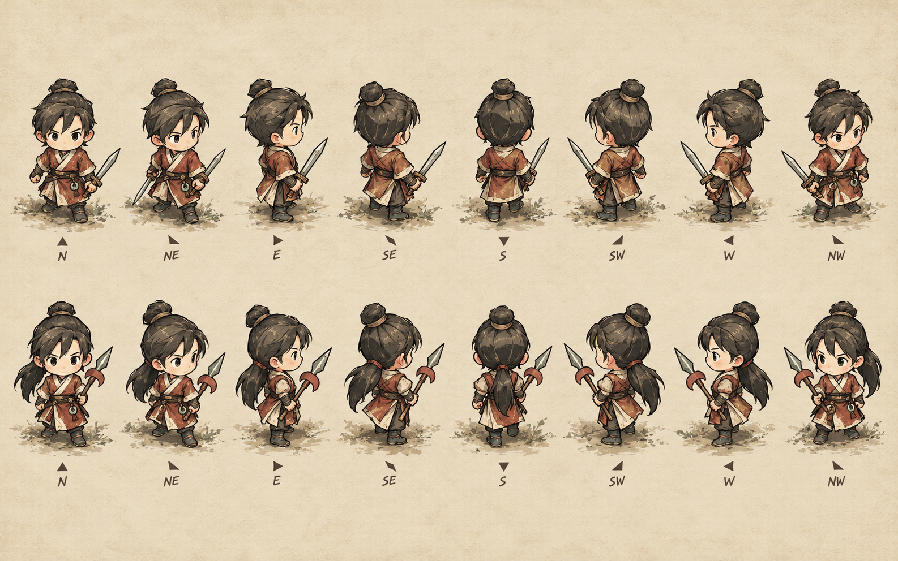
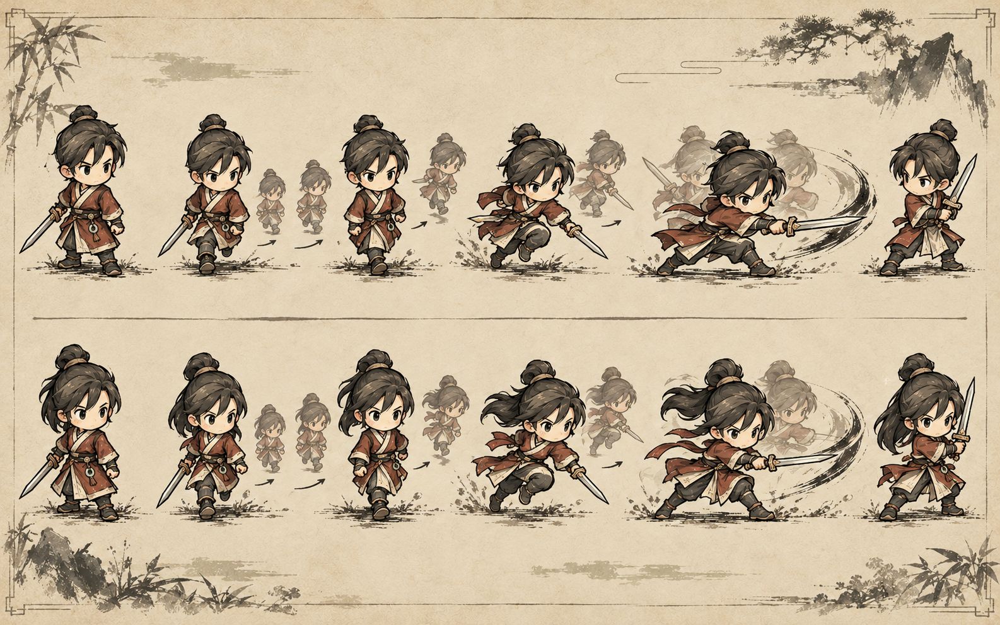
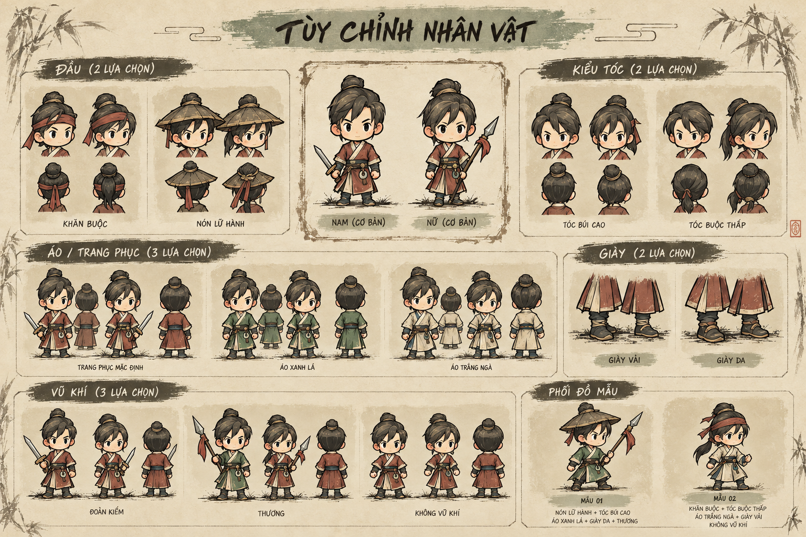
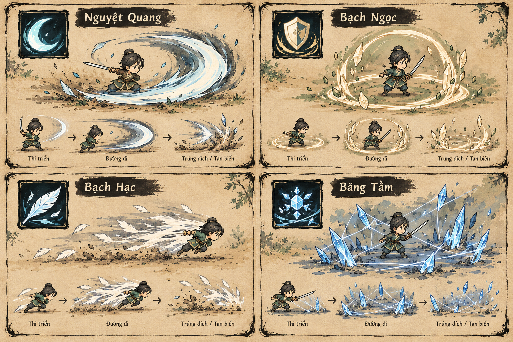

# Bộ concept duyệt 02 — nhân vật, trang bị và kỹ năng

Đây là concept mỹ thuật để duyệt hướng phát triển, không phải sprite sheet/frame animation đã sẵn sàng đưa vào game. Hình ảnh và tài liệu runtime hiện chưa thay đổi.

## Nhân vật đủ tám hướng

Nam và nữ có silhouette riêng; mỗi nhân vật được vẽ theo tám hướng N/NE/E/SE/S/SW/W/NW. Đây là turnaround mỹ thuật, không phải bằng chứng rằng mọi hướng đã có đủ frame chuyển động.

## Key pose di chuyển và hành động

Pose sheet diễn giải tư thế đứng, đi, chạy, đánh và thủ. Các ghost pose/motion strokes giúp duyệt trọng tâm, bước chân và độ trễ tóc/áo. Khi triển khai cần bổ sung cast, nhận đòn và các frame chuyển tiếp cho từng hướng.

## Trang bị lắp ghép

Concept minh họa hai kiểu đầu, tóc, ba lựa chọn áo, hai kiểu giày và ba dạng vũ khí. Đây là đề xuất hình ảnh; mũ/giày chưa được đưa vào code như slot trang bị mới.

## Icon và hiệu ứng bốn skill hiện tại

Giữ đúng bốn skill đang có: Nguyệt Quang, Bạch Ngọc, Bạch Hạc, Băng Tằm. Bảng này là hướng icon/hiệu ứng; cần chốt màu, độ sáng và hình dạng trước khi vẽ asset tách lớp.

## Đề xuất cấu trúc triển khai sau khi duyệt

- Hai bộ body nam/nữ với silhouette và mặt riêng, dùng cùng quy ước tên khớp.
- Tách hình theo hướng nhìn: thân/áo, tay gần và tay xa, tóc sau, đầu/mặt, tóc trước hoặc mũ, giày, vũ khí và bóng chân.
- Lưu pivot giữa hai chân; dùng điểm neo cho đầu, vai, cổ tay cầm, tay kia, hông, gối và mắt cá.
- Không lật gương hình hướng bất đối xứng. Đổi hướng thì đổi cả pose tay và tay cầm vũ khí.
- Animation đi/chạy cần bước có điểm tiếp đất rõ, đối chuyển tay/chân và nhịp áo/tóc; skill có cast, travel, impact/guard và fade.
- Slot mục tiêu: giới tính, kiểu tóc, mũ, áo, giày và vũ khí. Ma trận chi tiết thống nhất là 216 look: 2 body × 3 áo × 3 trạng thái nón (none/khăn/nón) × 2 tóc × 2 giày × 3 vũ khí. Đây là phạm vi dự kiến nếu duyệt, chưa triển khai.
- [Ma trận sản xuất và coverage frame](detail-02/PRODUCTION_MATRIX_03.md) bổ sung quy ước hướng, key pose, manifest và chia việc.

## Tài liệu

- [Hệ mỹ thuật và điểm neo nhân vật](character-visual-system-review-02.md)
- [Prompt tạo concept](prompts-review-02.json)
- [Concept nhân vật/UI trước đó](README.md)

**Trạng thái duyệt:** chờ bạn duyệt concept nhân vật, trang bị và hiệu ứng skill. Chưa sửa game runtime.
