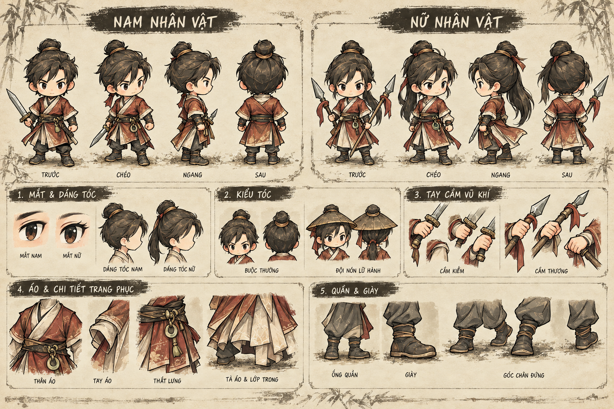
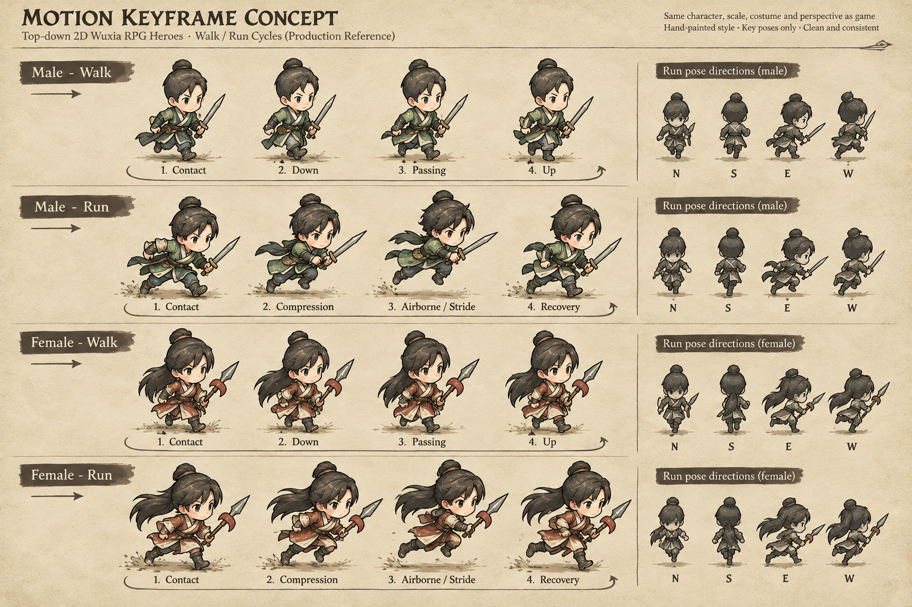

# Concept bổ sung 03 — chi tiết vật liệu và chu kỳ đi/chạy

Ngày 11/10/2026. Hai bảng dưới đây **bổ sung** cho bộ duyệt chi tiết 02, không thay thế 5 bảng refined hiện có. Chúng là nghiên cứu art direction/key pose; không phải nguồn alpha, rig, atlas hay animation đã chạy trong Godot.

## Cận cảnh tạo hình và điểm ghép

Bảng tập trung vào profile mặt, búi tóc/đuôi tóc, phần tóc bị mũ che, grip kiếm/thương, cổ tay áo, đai, tà áo và điểm tiếp đất của boot. Dùng để chốt cách vẽ và vùng overlap; source thật vẫn phải tách part/pivot theo FSD.

## Key pose đi/chạy

Bốn pha contact/down/passing/up và contact/compression/airborne/recovery làm rõ trọng tâm, độ nhấc chân và độ trễ tóc/áo cho hai body. Các hình nhỏ bốn hướng chỉ là silhouette gợi ý; chưa thể hiện đủ tám hướng. Chú thích trên bảng là gợi ý, cần author lại khi tạo source.

## Kết hợp với bộ concept 02

- Bộ duyệt chính và hình refined nằm trong [README chi tiết 02](README.md). Dùng các bảng locomotion/combat refined khi nhận xét pose cụ thể.
- Bản 03 giúp duyệt vật liệu và chu kỳ; không lấy giấy nền hoặc ký tự trong ảnh làm asset game.
- [Ma trận sản xuất 03](PRODUCTION_MATRIX_03.md) chốt coverage action, layer/manifest, 216 look và chia việc đội bốn người.
- [Prompt tạo ảnh](prompts-supplement-03.json).

**Trạng thái:** chờ người dùng duyệt hình trước khi bắt đầu code/asset runtime. Code, save schema, UI và art game chưa thay đổi.
