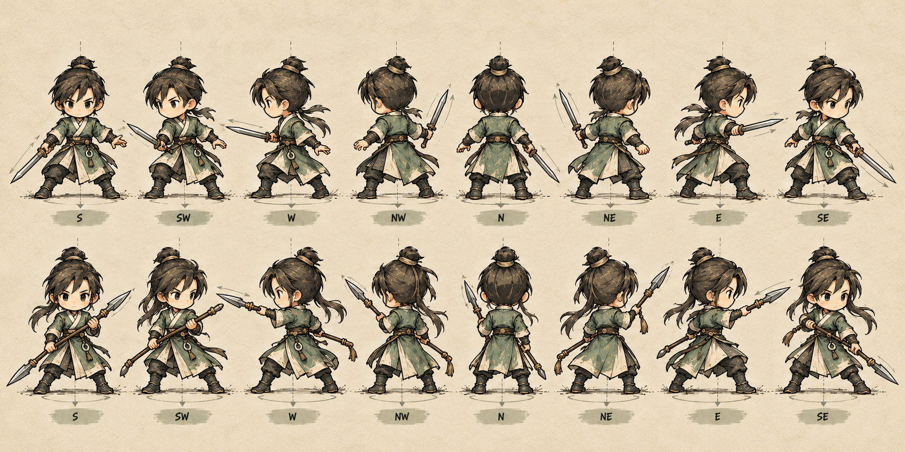
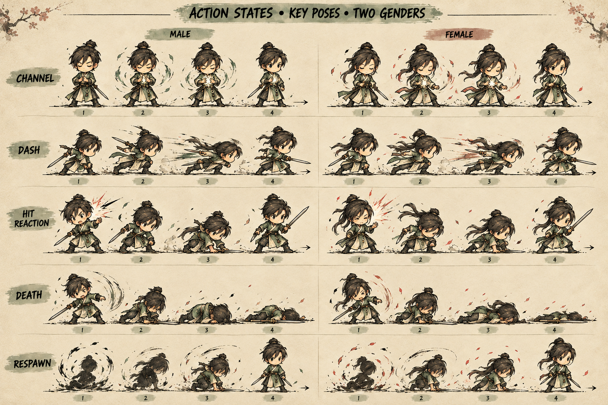
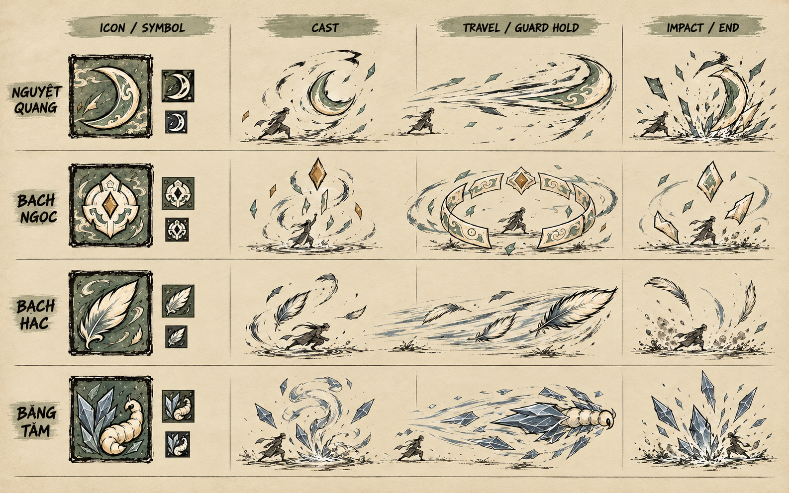

# Bổ sung concept 04 — grip, state transition và skill beats

Ngày 11/10/2026. Bộ này bổ sung góc nhìn chuyên biệt cho tay/vũ khí, state còn thiếu và nhịp hiệu ứng. Đây vẫn là concept để review, không phải atlas hay clip đã chạy.

## Grip kiếm/thương theo tám hướng

Hàng trên nghiên cứu kiếm một tay; hàng dưới nghiên cứu thương hai tay. Đánh giá vai gần/xa, dấu gập khuỷu, hướng blade/shaft, bàn tay hỗ trợ và thứ tự trước/sau thân. Giữ nguyên mapping S/SW/W/NW/N/NE/E/SE. Một số pose trong concept vẫn cần chỉnh khi author source; không phản chiếu hình làm hướng đối diện.

## Channel, dash, hit, death và respawn

Board cho thấy bốn key pose mỗi state ở cả nam và nữ. Đây là nghiên cứu silhouette và transition; không xác nhận thời lượng, invulnerability, va chạm hay điều kiện hồi sinh.

## Breakdown bốn skill

Giữ bốn Cổ hiện có và phân biệt bằng silhouette. Những mẫu icon nhỏ là kiểm tra hướng đọc trong concept, chưa thay thế phép thử native ở 32/48/64 px.

## Tài liệu cho pilot và phần mở rộng tiếp theo

- [Timeline pose và VFX](ACTION_TIMELINE_04.md)
- [Ma trận layer/coverage](PRODUCTION_MATRIX_03.md)
- [FSD modular](FSD_MODULAR_CHARACTER.md)
- [Acceptance gate](ACCEPTANCE.md)

**Trạng thái:** được dùng làm cơ sở cho pilot theo yêu cầu triển khai. Board vẫn là pose study; không xác nhận clip runtime hoặc thay đổi chỉ số skill.
