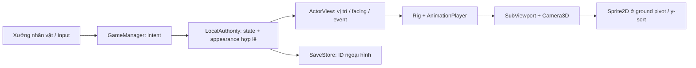

> Cập nhật 0.11: tài liệu này mô tả pipeline 0.10 trước khi chuyển sang pixel 2D. Runtime hiện tại theo [PIXEL_2D_MIGRATION_PLAN.md](PIXEL_2D_MIGRATION_PLAN.md).

# GuMaster2D — Kế hoạch model nhân vật và animation

Ngày: **08/10/2026**. Phạm vi: nhân vật người chơi trong Godot 4.7.2, PC Windows trước; đội 4 người tự phát triển, chưa có ngân sách mua asset. Đây là kế hoạch và đặc tả cho đợt xây nhân vật mới, bổ sung FSD/WBS alpha đã có. “Model nhân vật” gồm tạo hình, rig, animation, trang phục, vũ khí và màn hình xem thử.

Tài liệu liên quan: [FSD nhân vật](CHARACTER_MODEL_FSD.md), [WBS nhân vật](CHARACTER_MODEL_WBS.md), [kế hoạch Godot tổng thể](GODOT_IMPLEMENTATION_PLAN.md), [FSD alpha](../planning/GuMaster2D_FSD.md). Khi tài liệu alpha còn ghi Q/W/E/R, yêu cầu mới của người dùng có hiệu lực: **WASD di chuyển, phím số 1–4 dùng bốn Cổ hiện có**, 5–0 dành cho mở rộng.

## 1. Mục tiêu và giới hạn

Mục tiêu của đợt này là **polished prototype**: nhân vật có hình khối, khuôn mặt, tóc, phục trang, động tác và khả năng đổi ngoại hình đủ rõ để đánh giá trong game thật. Tiêu chí là chất lượng nhìn và sử dụng ở camera gameplay; không chỉ hoàn thành danh sách tên animation.

Nhân vật dùng tạo hình võ hiệp nguyên bản: dáng thanh, áo nhiều lớp, thắt lưng, tà áo, cổ tay và giày có cấu trúc; jade, đỏ thẫm và ngà làm ba hướng phục trang. Cảm hứng về độ rõ và bố cục game võ hiệp không đồng nghĩa sao chép model, texture, logo hay animation từ Võ Lâm Truyền Kỳ.

Đợt này không thay hệ kinh tế, tính damage, tốc độ cooldown, xác suất bắt Cổ hoặc quyền quyết định của mô phỏng bằng animation. Đổi giới tính, tóc, áo và vũ khí trong xưởng hiện là **ngoại hình**. Trang bị có chỉ số, combo cận chiến, animation interrupt theo luật chiến đấu, tạo nhân vật online và kho vật phẩm thời trang sẽ có đặc tả gameplay riêng.

## 2. Quyết định tạo hình và kỹ thuật

| Thành phần | Quyết định | Lý do / điều kiện nghiệm thu |
|---|---|---|
| Model | 3D stylized trong thế giới 2D isometric | Có chiều sâu và góc nhìn liên tục; tránh vẽ lại một bộ sprite cho mỗi tổ hợp ngoại hình |
| Render trong map | SubViewport nền trong suốt, Camera3D orthographic, texture gắn Sprite2D | Giữ WorldGrid, Camera2D và y-sort hiện có; chân trùng ground pivot |
| Rig | Skeleton3D dùng chung, AnimationPlayer và điểm gắn theo bone | Model nam/nữ, áo và vũ khí dùng chung tên bone và tỉ lệ chuyển động có kiểm chứng |
| Ngoại hình | ID ổn định, tách body / outfit / hair / weapon | Đổi từng phần không tạo thêm gameplay entity, không ghi Node hoặc Resource vào save |
| Body | `male`, `female` | Khác silhouette và tỉ lệ; không chỉ đổi màu hoặc tóc |
| Outfit | `jade`, `crimson`, `ivory` | Các phương án phục trang ban đầu; cần kiểm xuyên tà áo khi chạy/quỳ/ngã |
| Hair | `topknot`, `ponytail` | Dùng attachment đầu; kiểm góc sau và overlap cổ/vai |
| Weapon | `sword`, `spear`, `unarmed` | Gắn tay đúng điểm cầm; chiều dài spear không bị crop khỏi render texture |
| Hướng | 8 góc chuẩn để QA, xoay liên tục khi chơi/xem thử | N/E/S/W và bốn đường chéo có silhouette/đòn đánh đọc được |
| Asset về sau | Model authored có skin/weight, GLB import vào cùng rig contract | Giữ đường nâng chất lượng bằng Blender/Godot, không buộc art mãi ở mesh tạo bằng code |

Đợt này dựng **ArrayMesh có bone/weight thật, shared Skin với inverse bind transform và Skeleton3D 22 bone**; geometry được gộp theo material để tránh mỗi chi tiết thành một draw node. Đây là nền model 3D skinned, không phải các primitive không có skin ghép thành búp bê. Tuy vậy, hình học tạo bằng code cần được review trực quan; chưa tương đương sculpt/retopology/weight painting và texture được artist hoàn thiện. Khi chuyển sang authored mesh, lưu đúng rest pose, bone hierarchy, bind transform và socket để không viết lại phần gameplay.

Tổ hợp cơ sở là 2 body × 3 outfit × 2 hair × 3 weapon = **36 ngoại hình**. Kiểm tất cả tổ hợp ở ít nhất idle, chạy, attack peak và death; chỉ chụp một nhân vật mặc định chưa đủ xác nhận hệ modular.

## 3. Rig và ranh giới sở hữu

Rig được khai báo trong `scripts/presentation/character_model.gd`: `Hips`, `Spine`, `Chest`, `Neck`, `Head`; hai bên `Shoulder_L/R`, `UpperArm_L/R`, `Forearm_L/R`, `Hand_L/R`, `Thigh_L/R`, `Shin_L/R`, `Foot_L/R`; cùng `Hair`, `Cape`, `CapeTip`. Có **22 bone dùng chung** cho hai body. Điểm gắn vũ khí dùng tay phải/tay trái, lưng và phụ kiện dùng bone phù hợp. Tên bone, trục local, rest pose và đơn vị model phải được khóa trong source trước khi artist thứ hai làm quần áo. Không dùng tên hiển thị tiếng Việt làm ID bone hoặc asset.

Điểm cầm vũ khí được mô tả bằng transform theo socket, không chỉnh vị trí mesh độc lập trong mỗi frame. Bản 0.9 có `GuWeaponRig` mô tả transform cầm và điểm tay phụ; sword/spear/unarmed chọn ba thư viện animation đủ 11 action + RESET. Idle/walk/run/attack/defend có stance riêng. Thương dùng IK hai tay bake vào clip; đo FK 205 mẫu sai số lớn nhất 2 mm. Combo, pose fingers riêng và kiểm artist toàn bộ clearance vẫn còn trong backlog; animation không cấp damage.

- LocalAuthority sở hữu cell, HP, mana, damage, capture và tùy chọn sprint nếu có. Chỉ command hợp lệ mới thay state.
- ActorView đọc state/event, chọn hướng và động tác; không gọi `_damage_player`, `_damage_mob`, feed hoặc cấp thưởng từ animation.
- Model/renderer sở hữu mesh, material, ánh sáng, skeleton, clip và camera riêng. Có API freeze cho portrait; không phụ thuộc UI hoặc SaveStore.
- Xưởng giữ bản nháp appearance. Nút áp dụng gửi intent; nút đóng/hủy không âm thầm đổi profile.
- Save chỉ lưu enum/ID appearance; save schema 1 không có appearance vẫn dùng ngoại hình mặc định. Dữ liệu sai phải được từ chối hoặc chuẩn hóa theo chính sách đã test, trước khi mutate player.

ActorView có thể bind trước khi vào SceneTree; headless tests không được cần GPU để kiểm state hoặc clip. WorldView giữ ground position bằng WorldGrid.project; nâng model lên camera 3D không làm đổi collision hay tọa độ cast.

API đang được tích hợp: `GuCharacterModel.set_appearance()` dựng các lớp; `set_motion(action, time, facing, reduced)` lấy mẫu AnimationPlayer theo thời gian do caller cấp; `hand_position()` cung cấp anchor theo skeleton. `GuCharacterViewport` trong `scripts/presentation/character_viewport.gd` chuyển model sang Sprite2D bằng viewport/camera trong suốt, với `present()`, `set_active()` và ground pivot. ActorView dùng `character_view` trong world; GuCharacterDoll dùng GuCharacterViewport trực tiếp cho portrait tĩnh. Renderer không có clock animation độc lập, để portrait/pause không chạy lệch action.

## 4. Bộ động tác và thứ tự ưu tiên

| Động tác | Hành vi | Vùng kiểm chất lượng |
|---|---|---|
| Idle | Thở nhẹ, trọng tâm ổn định, tay và vạt áo không bất động cứng | Không rung chân; mặt/tóc/vai đọc được ở cả trước và sau |
| Walk | Hai pha chân, trọng tâm và tay đối hướng | Contact/down/passing/up; không trượt hoặc xoắn chân |
| Run | Sải chân và thân nghiêng khác walk | Tốc độ clip gắn quãng đường render, không đổi tốc độ mô phỏng |
| Attack | Anticipation → contact → recovery | Tay giữ chuôi, cung đòn rõ, không đánh bằng vị trí vũ khí giật tức thời |
| Defend | Hạ trọng tâm, bảo vệ thân trước, có recovery | Khác idle; shield gameplay vẫn do Cổ số 2 quyết định |
| Cast | Chuẩn bị tay, release và hồi tay | Hướng khóa theo lệnh được nhận; VFX từ socket thay vì tọa độ cũ của hình 2D |
| Channel | Vòng lặp niệm/bắt Cổ | Facing theo mục tiêu, hủy đúng event, không kéo dài sau capture cancel |
| Dash | Tư thế lao, gọn silhouette, hồi về đứng/chạy | Quỹ đạo theo endpoint hợp lệ; không lùi lại vì nội suy pose |
| Hit | Co thân có giới hạn, trở về action đang còn hiệu lực | Không overwrite death; tránh flinch lặp gây mất đòn |
| Death | Hạ trọng tâm/ngã và giữ pose cuối | Không loop; không trượt ground pivot; cửa sổ UI không làm actor sống lại |
| Respawn | Hiện lại, chuyển về pose đứng | Không giữ pose death hoặc action cũ; cell theo authority |

Quy tắc ưu tiên cần nằm trong một bộ chọn state duy nhất: **death > respawn > dash/action được nhận > channel > hit có giới hạn > locomotion > idle**. Defend/cast/attack là action thay vì một flag độc lập có thể cùng điều khiển xương. Vị trí thế giới luôn do authority và presentation interpolation cung cấp; clip dùng in-place, không thêm root motion vào cell.

Trong map hiện có, bốn Cổ kích hoạt cast, shield/defend và dash; bộ attack đầy đủ được xem trong xưởng để xây nền cho cơ chế vũ khí sau. Không ghi rằng chọn sword/spear đã bổ sung damage cận chiến nếu chưa có command/melee rules.

Thời lượng và blend là thông số cần tune theo event thật. Clip one-shot giữ contact/recovery dễ đọc nhưng không làm input phải đợi hết animation để được authority xét. Chạy bộ cần khác walk bằng cadence, độ mở chân và torso; không chỉ tăng tốc cùng một clip.

## 5. Xưởng nhân vật và trải nghiệm kiểm tra

Phím **F6** mở xưởng từ game hoặc từ bảng nhân vật. Preview lớn có ánh sáng riêng và nền đủ tương phản; hỗ trợ chọn giới tính, trang phục, tóc, vũ khí, động tác và góc. Góc nhìn cần điều khiển trực tiếp, các hướng có nhãn rõ, không bắt người xem chờ animation tự xoay để kiểm phía sau.

Xưởng cho phép chọn idle/walk/run/attack/defend/cast/channel/dash/hit/death/respawn. Nếu có pause/seek, scrub không được gọi gameplay event. Nút áp dụng chỉ áp dụng appearance. Đóng xưởng bằng Esc theo window stack; mở xưởng chặn input di chuyển/skill phía sau và xóa phím đang giữ. Khi đóng, nhân vật đứng yên cho đến input mới.

Walk/run cần được kiểm trong map thật bằng WASD, không chỉ ở showroom. Nếu đưa sprint vào đợt này: Shift+WASD chạy và preview đổi sang Alt; hướng dẫn, HUD, input gate và kiểm tốc độ của LocalAuthority phải được cập nhật đồng bộ. Đây là thay đổi control có acceptance riêng, không được thêm tốc độ chỉ ở renderer.

Portrait bảng nhân vật/hành trang dùng cùng appearance và rig. Preview ẩn phải ngừng cập nhật render; portrait đứng yên cần render một lần sau khi đổi ngoại hình. Chỉ tắt `_process` ở ActorView không đủ nếu renderer con vẫn chạy.

## 6. Ngân sách kỹ thuật và gate art

Các số sau là **ngân sách đề xuất**, chưa phải kết quả đo: hero 12–20 nghìn tam giác sau tối ưu; texture render gameplay 256–384 px mỗi chiều, preview lớn 768–1024 px theo máy; material dùng lại, tránh bóng động nặng hoặc shader chỉ chạy Forward+. Quyết định cuối phải dựa vào đo trên máy mục tiêu, không tuyên bố tăng FPS từ cảm giác.

Vì dùng SubViewport, mỗi preview/actor có thêm render pass. Prototype hiện chỉ có một hero 3D; không suy ra chiến trường 20 người đã đạt FPS. Khi tăng actor, so sánh dùng chung thế giới 3D, viewport pool và sprite bake từ cùng source rig. Web được kiểm sau PC và có thể cần chất lượng thấp hơn; không tự ghi Web đã hỗ trợ chỉ vì dùng Compatibility.

| Gate | Điều kiện chấp nhận | Evidence cần có |
|---|---|---|
| A — silhouette | Trước/sau/trái/phải và 4 góc chéo phân biệt tay/chân/tóc/vũ khí | Contact sheet 8 góc + ảnh ở zoom gameplay |
| B — model | Thân có tỉ lệ nhất quán, đầu/mặt/tay/giày có cấu trúc; áo có lớp và seam/trim | Preview lớn, 36 tổ hợp, ghi lỗi clipping còn lại |
| C — animation | Walk/run khác nhau; attack/defend/cast có anticipation/contact/recovery; death giữ pose | Video/GIF capture native, freeze contact poses |
| D — integration | Chân không nổi/trượt, VFX đúng tay, y-sort/props/camera không sai, UI cùng ngoại hình | Playtest WASD/click + 4 Cổ + capture/death/respawn |
| E — budget | Import/test sạch, không leak; số viewport/tam giác/material và frame time được đo | Log Windows/Linux; benchmark riêng ở máy mục tiêu |
| F — production art | Authored mesh có topology/weights/UV/texture hợp lệ; vũ khí có grip và clip riêng | Review artist + model source + GLB round-trip + asset manifest |

Đợt prototype có thể hoàn thành A–D cho phạm vi được capture và một phần E; F là chặng tiếp theo. Kết quả test logic không thay được nhận xét silhouette, độ mềm khớp hay chất lượng mặt. Chưa có benchmark thì E ghi “chưa đo”, không điền số dự đoán vào evidence.

## 7. Đợt đang thực hiện và lộ trình kế tiếp

| Đợt | Đầu ra | Trạng thái tại thời điểm lập kế hoạch |
|---|---|---|
| Đợt 0.8–0.9 | Model nguyên bản, rig chung, 11 nhóm động tác, world/portrait/F6, appearance save, ba wardrobe geometry và ba weapon motion family | Đã có implementation; phạm vi kiểm chứng xem quality report và acceptance |
| Sprint art 1 | Chốt tỉ lệ và clip, sửa lỗi góc sau/weapon/crop, lập dữ liệu hiệu năng | Kế hoạch 2 tuần đầu; phụ thuộc bản mới chạy được |
| Sprint art 2 | Sculpt/retopology, texture paint/bake, artist clearance, loader cho asset chỉnh tay | Có nguồn Blender/UV/texture procedural và clip theo weapon từ 0.9; chưa có final artist hoặc melee combat |
| Sprint art 3 | QA đủ tổ hợp, tối ưu máy mục tiêu, export/import source, chuẩn bị content thêm | Kế hoạch; tùy kỹ năng art và giờ thực tế của đội |

Forecast chi tiết **6–8 tuần** cho nhóm làm part-time, tại [WBS](CHARACTER_MODEL_WBS.md). Phải cập nhật sau một sprint có velocity thật; phiên implementation của trợ lý không được tính là toàn bộ công sức artist của chặng production.

## 8. Quy trình mỗi asset và mỗi lần bàn giao

1. Chốt concept front/side/back, tỉ lệ và điểm nhấn đọc ở camera game; phê duyệt bằng ảnh prototype đang render.
2. Dựng body/cloth/hair/weapon riêng; khóa rest pose và socket. Lưu source, revision, người làm và giấy phép nếu dùng asset bên ngoài.
3. Rig/weight hoặc bone attachment thử; animate pose chính trước, sau đó chỉnh đường chuyển động và secondary motion. Không làm cloth physics trước khi silhouette và contact đúng.
4. Import vào Godot đúng engine; chạy xưởng 8 góc/11 nhóm động tác/36 tổ hợp; sửa clipping và camera crop trước khi thêm costume mới.
5. Chơi trong map với WASD/click, số 1–4, capture, chết/hồi sinh; kiểm pause, reduced motion, F3/F4/F6 và thay appearance lúc đang action.
6. Chạy test headless Windows/Linux; capture native 1280×800 và kiểm UI nhỏ 960×640. Ghi scene/source, clip lengths, build hash và lỗi chưa giải quyết.
7. Package source + evidence; asset mới chỉ chuyển trạng thái “đã nghiệm thu” nếu cả test hành vi và review hình ảnh đạt.

## 9. Rủi ro và xử lý

| Rủi ro | Biểu hiện | Chủ trì / cách xử lý |
|---|---|---|
| Tạo hình vẫn thô dù đủ animation | Mặt/tay/khớp giống khối ghép, áo phẳng | AR khóa silhouette và kiểm ảnh lớn trước khi thêm chi tiết; chuyển authored mesh khi cần |
| Tà áo/weapon xuyên model | Chạy, defend, death gây overlap | TA dùng 4 pose stress cho mọi wardrobe; clearance theo socket, clip theo weapon |
| Render texture mất đầu/giáo | Một góc hoặc attack vươn tay vượt khung | CL có bounds/safe margin; preview và world dùng camera preset riêng |
| Actor sống ở pose chết/cast cũ | Timer/state cùng ghi vào rig | CL/TA một selector và lifecycle reset; test death/respawn giữa action |
| Avatar/portrait gây render pass thừa | F3/F4 mở rồi đóng vẫn chạy viewport | CL có freeze API, visible/update budget và leak check |
| Tốc độ/đòn đánh thay bởi clip | Animation method-track cấp damage hoặc root motion sửa cell | CL/GD giữ authority độc lập, test invariant khi seek/play |
| Save cũ hỏng | Profile không có appearance hoặc ID không hợp lệ | CL kiểm schema1 default/validation/backup; không mutate state nửa chừng |
| Công suất art thiếu | Một người AR gánh cả mesh, skin, UV và clip | GD cắt số bộ áo/weapon final trước, giữ rig và chất lượng một bộ; không bỏ gate QA |

Chất lượng mong muốn là một nhân vật game có thể phát triển tiếp và có bằng chứng trong native runtime. Hình học tạo bằng code, clip thủ công trong engine và screenshot đẹp không tự chứng minh chất lượng production hoặc hiệu năng đa nền tảng.

## 10. Kết quả implementation 0.9 và công việc tiếp

Nền 0.8 giữ rig 22 bone, world/portrait/F3/F6, 8 hướng và yaw 360°, 11 action, playback, 36 cosmetic combinations và save schema1. Bản 0.9 cải thiện hình học mặt/đầu/vai, sleeve skinned nối vào Chest, vạt áo có độ cong; ba thiết kế trang phục khác hình học thật. Mười map SVG 512 px vải/da/tóc/kim loại có UV, albedo/normal và tangent từ đạo hàm UV. Idle/walk/run/attack/defend của kiếm/thương/tay không khác actual FK; thương giữ hai tay.

Sáu model baked `.glb`/`.tscn` theo body/weapon tại `assets/characters`: 19.024–19.624 triangles, 13–15 material surfaces, 22 bone, 12 clip gồm RESET. Nguồn `.blend` giữ geometry/UV/weights/normal/action và đóng gói texture; [pipeline](CHARACTER_ART_PIPELINE.md) mô tả mở và chỉnh tiếp. Runtime dùng generator, nên đổi nguồn Blender phải đi qua chặng loader GLB/wardrobe để trở thành model game.

Camera orthographic size 3.6 kiểm 1.584 view đại diện × action/time/direction; gameplay dùng viewport 384 px, giữ chiều cao/pivot qua adapter. Walk/run/cast/defend/capture/death/respawn và giao diện kiểm lại bằng suite Windows/Linux và native capture. Điều khiển WASD, Shift chạy 4,8 ô/s, Alt xem lướt, 1–4 dùng Cổ. Xem [quality report](../game-studio/quality-report.md) và [acceptance](CHARACTER_POLISH_ACCEPTANCE.md) cho số test/hash và giới hạn thực.

Chặng tiếp do artist làm: sculpt nét mặt và anatomy, retopology deformation, UV atlas/texture paint/bake, secondary cloth/hair và clearance từng tổ hợp. TA/CL tiếp tục loader asset, combo/melee rules khi được thiết kế, benchmark frame-time/multihero trước Web. Nguồn editable và test logic không đóng gate F production; WBS 6–8 tuần là forecast từ kế hoạch gốc, cần re-estimate theo kỹ năng/velocity của nhóm.
