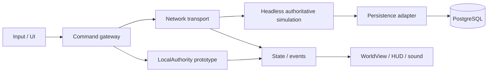

# GuMaster2D — Kế hoạch code Godot

Ngày cập nhật: 07/10/2026. Đội 4 người tự phát triển, ngân sách tiền mặt hiện tại 0. Người dùng đã yêu cầu dùng Godot và bắt đầu implementation. Chọn PC Windows native trước; Web là mục tiêu kiểm chứng tiếp theo, mobile sau alpha. Đây là kế hoạch triển khai tiếp nối FSD/WBS, không thay phạm vi alpha bằng prototype nhỏ hiện tại.

Backlog Excel/CSV đi kèm: `Godot_Coding_Backlog.xlsx`, `Godot_Coding_Backlog.csv`. Nguồn là bảng ở phần5; chạy `tools/generate_coding_backlog.py` để tạo lại.

## 1. Bản đã bắt đầu

`project.godot` chạy với **Godot 4.7.2 stable, GDScript, Compatibility**. Đã có một bản đồ Vạn Thú Sơn 28×28, click tìm đường A*, camera, chọn sói, 4 Cổ phím số1–4, WASD/click di chuyển, Shift chạy, AI có báo trước đòn đánh, HP/mana/cooldown, bắt Cổ, cho ăn, túi 30 ô, chiến lợi phẩm chờ khi đầy túi, XP/cấp, một khảo nghiệm, chết/hồi sinh và lưu local có bản dự phòng. Nhân vật 3D skinned render trong world 2D; cây/sói/UI vector và hiệu ứng âm thanh được tạo trong dự án, chưa cần asset trả phí.

Đây là **first playable chơi đơn để thử cảm giác và luật**. Chưa có login, client thứ hai, server, PostgreSQL, luyện chế, đổi loadout, passive, NPC shop, party, dungeon, PvP hoặc GM. Không đánh dấu các yêu cầu server hay gate G2/G3 hoàn thành từ test local.

Prototype có 4 Cổ, trong khi G2 của kế hoạch alpha cần 5. Bộ khởi đầu cố định; bắt được Cổ vào túi nhưng chưa đổi vào hotbar được. Nguyệt Quang khởi đầu có 82 no đủ để thử cho ăn ngay; các Cổ mới bình thường bắt đầu 100. Khảo nghiệm 3 kill / 1 capture / 1 feed là nội dung sandbox, chưa thay thế 10 quest FSD.

## 2. Quyết định công nghệ

| Thành phần | Quyết định | Mục đích / điều kiện |
|---|---|---|
| Engine | Pin Godot 4.7.2 stable | Cùng phiên bản cho cả đội và CI; chỉ nâng khi có nhánh kiểm chứng |
| Ngôn ngữ | GDScript có annotation ở ranh giới | Một codebase gameplay dùng lại ở headless server; giữ hướng Web |
| Renderer | Compatibility | Phù hợp 2D và hướng Web; benchmark máy mục tiêu vẫn còn phải làm |
| Navigation | AStarGrid2D + sweep theo grid | Không cắt góc vật cản; collision tính trên tọa độ world |
| Simulation | RefCounted, fixed step 20 Hz | Không phụ thuộc scene/UI, chạy test và có thể chuyển sang server |
| Presentation | Node2D + Camera2D + CanvasLayer | View chỉ đọc state, nhận event và vẽ hiệu ứng |
| Content | JSON versioned | Khởi đầu 4 definition; bổ sung schema validator trước khi mở 20 Cổ |
| Save prototype | JSON user://, tmp + bak | Tiến độ local; không phải database transaction hay cơ chế chống sửa save |
| Multiplayer sắp tới | Godot headless authority | Intent từ client; server validate và phát snapshot/event |
| Transport spike | ENet cho PC/LAN; WebSocket cho hướng Web | Chốt sau thử hai client; không cố đưa ENet UDP trực tiếp vào trình duyệt |
| Persistence alpha | PostgreSQL + service adapter phía server | Chốt driver/service trong spike; không nhét mật khẩu DB vào client |
| CI | Headless import + gameplay checks + export | Bắt lỗi parse/runtime; bổ sung transaction/fault tests khi có DB |

Godot hỗ trợ headless server. Web export dùng Compatibility/WebGL2; bản Godot 4 C# chưa hỗ trợ Web export. Vì thế dự án chọn GDScript; Web single-thread và baked WAV sẽ được kiểm chứng trong spike, chưa có bản Web đã export. Các quyết định thiết kế khác trong bảng là đề xuất của dự án. Tham khảo [Web export](https://docs.godotengine.org/en/stable/tutorials/export/exporting_for_web.html), [high-level multiplayer](https://docs.godotengine.org/en/stable/tutorials/networking/high_level_multiplayer.html), [dedicated servers](https://docs.godotengine.org/en/stable/tutorials/export/exporting_for_dedicated_servers.html).

## 3. Cấu trúc và quyền sở hữu

```text
project.godot
scenes/main.tscn
scripts/core/           GuCatalog, WorldGrid, InventoryModel, LocalAuthority, SaveStore
scripts/gameplay/       GameManager, GameInputController
scripts/presentation/   WorldView, GroundView, PropView, ActorView, WorldEffects, SoundLayer
scripts/ui/             GameHUD, SkillButton, GuMinimap
data/                   gu_catalog.json
assets/                 icon.svg, audio/*.wav
tests/                  test_runner.gd
tools/                  run.sh, generate_audio.py
docs/implementation/    kế hoạch code, backlog, traceability
docs/planning/          FSD / WBS / lịch alpha 36 tuần
```

Luồng hiện tại: input → command `move_to/cast/begin_capture/feed_gu` → LocalAuthority validate/mutate → event queue → view/HUD/audio. GameManager điều phối fixed step, pause và save; view không quyết định damage hoặc tiền. WorldGrid quản lý hình học; InventoryModel quản lý instance/capacity/feed receipt. SaveStore chỉ ghi/đọc profile.

Khi làm online, thay lời gọi local bằng CommandGateway, giữ cùng payload intent; authority server tự tìm đường và tính kết quả. Snapshot vào client là bản đọc, không đưa dictionary sống của server qua RPC. Tách runtime entity state khỏi profile bền vững, thêm character/session/command ID, configVersion, sequence và quyền sở hữu. Hành vi hiện có được giữ bằng scenario test trước khi thay transport.

Sơ đồ mục tiêu:



Không tạo ngay hệ thống guild, generic ECS, microservices hoặc abstraction cho mọi effect. Trước mắt chuẩn hóa command/result, schema content và kiểu ActorState khi thêm remote actors. Tách GameHUD thành các scene Bag/Pause/Hotbar ở sprint kế tiếp để artist có thể chỉnh trong editor; hiện HUD dựng bằng script để kiểm chứng nhanh.

## 4. Truy vết prototype vào FSD/WBS

Mọi dòng dưới đây là **một phần / local**, chưa đạt AC toàn bộ của FSD.

| FSD | WBS liên quan | Evidence hiện có | Phần còn lại |
|---|---|---|---|
| CL-003, CL-004 | T01-CL, T02-CL, T03-CL | WorldGrid, WorldView; tìm đường, sweep, input, screenshot | Server xác nhận, camera clamp, kiểm máy/resolution chính thức |
| CL-005, CL-006 | T03-CL, T04-CL, T06-CL | Chọn sói, target HP, minimap | NPC/autowalk/portal/party/AOI/handoff |
| CL-007–CL-010 | T04-AR, T05-CL, T05-AR | 4 Cổ, phím1–4/WASD/click, mana, cooldown, FX | Cổ thứ 5, remap, AoE/cast bar/stun/heal, server events |
| CL-011, CL-012 | T06-CL, T06-SV | AI, kill once local, loot, penalty một lần, respawn | Hai client/owner, durable reward receipt, inbox chuẩn 100 entry |
| CL-013 | T07-CL | 30 ô dạng grid, stack 99, Gu unique, filter/sort UI, overflow local | Drag/drop, equip và nghiệm thu inventory alpha |
| CL-016, CL-017 | T08-CL | HP/tầm/seal/channel/RNG/cancel, feed/version/retry | Exclusive claim nhiều client, transaction, offline/session policy |
| CL-020, CL-021, CL-029 | T10-CL, T03-GD | XP curve, khảo nghiệm, hướng dẫn | Rank II, 10 quest, onboarding thử với người mới |
| SV-005, SV-006, SV-010 | T05-SV, T06-SV, T08-SV | Logic local làm reference cho server | Server độc lập, auth, concurrency và persistence |

`tests/test_runner.gd` kiểm chứng implementation hiện tại. Các testcase alpha trong workbook vẫn “Chưa chạy”; không đổi chúng sang Passed bằng test prototype. Pending material hiện gộp theo loại và tự nhận khi có chỗ, khác inbox 100 entry + ledger của FSD. Save local phục hồi full HP/mana và reset encounter/cooldown sau restart; không đáp ứng recovery chiến đấu online.

## 5. Sprint code tiếp theo — 2 tuần

Giả định mỗi người 20h/tuần, focus 75% → 30 giờ hữu ích/người/sprint. Tổng 120h. Backlog dưới đây 84h cơ sở +20% dự phòng = **100,8h**, còn 19,2h công suất. Đây là effort còn lại đề xuất, chưa phải giờ đã tiêu trong phiên này. Người dùng chưa chốt availability thực tế.

| ID | Owner | Việc cụ thể | Giờ base | Dependency | Tiêu chí xong |
|---|---|---|---:|---|---|
| G01 | GD/QA | Rà luật prototype, ghi 10 ca chơi, chốt tên vai trò và máy test | 6 | Bản hiện tại | Issue có bước tái hiện; danh sách AC được chấp nhận |
| G02 | GD/QA | Chuẩn bị 5 Cổ đầu và test matrix G1 | 8 | G01 | Data/cost/duration/range/food có đơn vị; 10 negative cases/primitive |
| G03 | CL | Tách Bag/Hotbar/Pause thành scene, thêm input actions/remap cơ bản | 8 | Bản hiện tại | UI chỉnh được trong editor; không rò click; test cũ vẫn đạt |
| G04 | CL | CommandGateway, typed snapshot và remote actor interpolation | 10 | G07 phối hợp | Client không sửa authority; hai avatar hiển thị đúng ID |
| G05 | CL | Spike Windows export + Web single-thread | 6 | G03 | Ghi version/templates/size/FPS; login chưa có được ghi rõ |
| G06 | SV | Headless server shell, session test và command validation | 8 | Bản hiện tại | Hai client LAN kết nối; server sở hữu movement/cooldown |
| G07 | SV | Protocol v1 + ENet spike; đánh giá WebSocket adapter | 8 | G06 | Sequence, denial, snapshot; duplicate/out-of-order không làm warp |
| G08 | SV | PostgreSQL/service adapter spike cho feed receipt | 8 | G06 | Cùng UUID 20 retry và hai kết nối chỉ consume 1; rollback khi lỗi |
| G09 | AR | Style guide, chỉnh avatar/sói và silhouette trong scene hiện có | 8 | Bản hiện tại | Nhân vật/mục tiêu đọc rõ ở 1366×768; asset manifest |
| G10 | AR | Bộ 5 icon và tín hiệu ready/cooldown/đói/không đủ mana | 8 | G02, G03 phối hợp | Skill trạng thái đọc được khi mute và không chỉ dựa màu |
| G11 | AR | Chỉnh collision/đường đi, mép map và vùng trại | 6 | G01 | 10 đường qua props không kẹt; ranh safe zone khớp mô phỏng |

GD 14h → 16,8h gồm dự phòng; CL 24h → 28,8h; SV 24h → 28,8h; AR 22h → 26,4h. Phối hợp trong sprint không có nghĩa G04 đợi G07 hoàn toàn: ngày 1 chốt payload mẫu, dùng stub gateway trong lúc server đang làm. Nếu SV thiếu thời gian, ưu tiên ENet PC và feed transaction; Web transport dời sprint sau.

Lịch đề xuất: ngày 1 review/chốt payload; ngày 2–4 scene/core/server spike; ngày 5 build chung và sửa blocker; ngày 6–8 protocol + DB fault tests; ngày 9 thử máy Windows khác và ghi Web spike; ngày 10 demo hai client và re-estimate. Demo online phải có server chạy riêng, không mô phỏng hai avatar cùng một authority trong client.

## 6. Thứ tự sau sprint này

| Chặng | WBS gốc | Đầu ra code ưu tiên | Gate |
|---|---|---|---|
| Foundation, S01–S04 | T01–T04 | Godot shell → auth/session → movement authority → AOI/snapshot | G1 hai client, sai quyền/tốc độ bị chặn |
| PvE, S05–S06 | T05–T06 | 5 Cổ, combat/state, AI/loot/death có receipt | G2 PvE online, 10 phiên 15 phút |
| Vòng Cổ, S07–S12 | T07–T12 | Bag/equip → capture/feed → refine/pity → quest/rank/shop → content20 → recovery | G3 core loop end-to-end, fault/dupe |
| Social, S13–S15 | T13–T15 | Party/chat → dungeon/boss → duel | G4; cắt social trước khi cắt persistence |
| Hardening, S16–S18 | T16–T18 | GM/metrics → load/perf/UAT → restore/release | G5 closed alpha giới hạn |

36 tuần vẫn là forecast của kế hoạch cũ, chưa được đo lại sau khi chọn Godot. Phần làm prototype trước lịch không tự rút ngắn critical path server. Sau spike hai client và DB, dùng velocity thật để rebaseline effort/ngày. Chưa commit deadline thương mại.

## 7. Quy trình code và kiểm tra

Mỗi task một nhánh nhỏ và người review khác; PR mô tả trigger/kết quả/test. Không trộn thay renderer, protocol và economy vào một commit. Content có ID ổn định; thay cân bằng tăng configVersion. Chỉ viết test hành vi có rủi ro hoặc logic dùng lại; chỉnh màu/spacing kiểm trực quan.

Trước merge: headless import sạch → scenario tests đạt → mở scene thật → thử input/Tab/Esc → đóng mở lại giữ tiến độ. Khi có server: thêm hai client, duplicate/concurrent command, process crash trước/sau commit, stale session, quyền sở hữu và DB unavailable. Build tag phải gắn engine/config/schema.

Chạy trên Linux: `bash tools/run.sh --headless --import`, rồi `bash tools/run.sh --headless --script tests/test_runner.gd -- --test-mode`. Windows có `RunTests.bat`. Test dùng profile riêng dưới `user://automated_tests`, không ghi profile người chơi.

Rủi ro hiện tại: chưa có peer review của đội; chưa benchmark máy mục tiêu; chưa nghe/đánh giá âm thanh với người dùng; chưa có Web export; nhiều dictionary runtime cần chuẩn hóa khi thêm network; local save chỉnh được và không cung cấp bảo đảm kinh tế online. Những việc này có owner và gate ở backlog, không cản thử prototype hiện tại.

## Nhân vật 3D — 08/10/2026

Đợt0.8 đã có model/rig/11 clip, xưởng F6, cosmetic save, model GLB/scene. Xem [kế hoạch nhân vật](CHARACTER_MODEL_PLAN.md), [FSD](CHARACTER_MODEL_FSD.md) và [WBS](CHARACTER_MODEL_WBS.md) cho phạm vi hiện tại và forecast6–8tuần art final.
